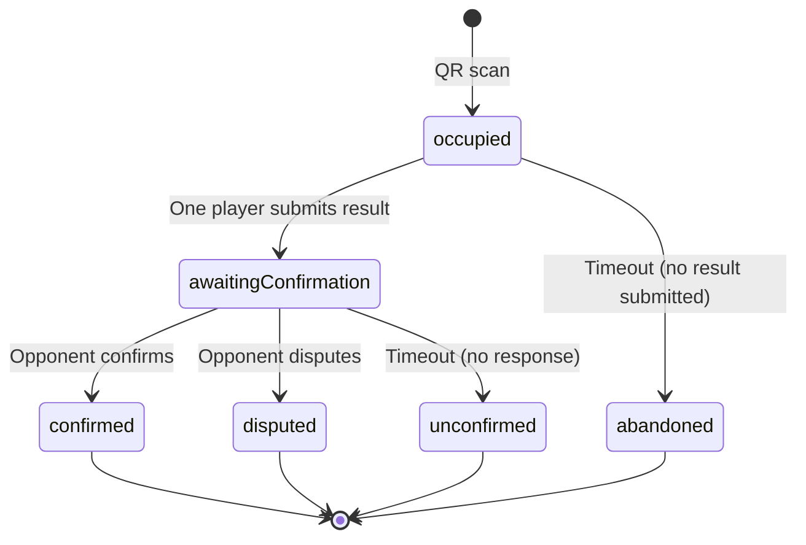

# CampusArena — Firestore Schema

> **Purpose:** Locked document shapes, paths, and relationships for all Firestore collections. Every field traces to a concrete screen, business rule, or decision in the [project description](file:///Users/mirko/Developer/CampusArena/brain/project_description.md). Change it if building against it reveals a problem — but document the reason.

---

## Relationship Overview

```mermaid
erDiagram
    USERS {
        string uid PK "Firebase Auth UID"
        string name "Display name"
        string username "Unique handle (lowercase-only, case-insensitive)"
        string email "Login email"
        string degreeProgram "Fixed dropdown (Polimi programs)"
        string language "en | it"
        array pushTokens "List of active FCM device tokens"
        array friendUids "List of friend UIDs"
        map badges "achievementId → timestamp earned"
        bool onboardingComplete "First-launch gate"
        number disputeCount "Increments on dispute; >=3 triggers penalty and resets to 0"
        timestamp disputePenaltyUntil "Nullable — end of 7-day cooldown"
        timestamp createdAt "Registration timestamp"
    }

    RATINGS {
        string ratingId PK "Deterministic: sportId_ownerId"
        string ownerType "user | pair"
        string ownerId "uid or deterministic pairId"
        array memberUids "Only set when ownerType = pair"
        string sportId "ping_pong | foosball | padel"
        string degreeProgram "Denormalized from user doc (ownerType=user only)"
        number elo "Starts at 1200"
        number matchesPlayed "Drives K=32 → K=16 switch at 10"
        timestamp lastMatchAt "For lazy inactivity decay at read time"
    }

    FACILITIES {
        string facilityId PK "Auto-generated doc ID"
        string name "Human-readable (e.g. Table 3 - BL27)"
        string sportId "ping_pong | foosball | padel"
        geopoint coordinates "Lat/lng for map pin + weather fetch"
        string qrCode "Value encoded in the physical QR sticker"
        string fallbackCode "Printed alphanumeric manual-entry code"
        bool isOutdoor "Single source of truth for weather visibility"
        string status "free | occupied | queued"
        string currentMatchId "Nullable FK → matches/{matchId}"
        string kingOfTableUid "Nullable — UID with most wins here"
        number kingOfTableWins "Win count for the king"
        number queueTailPosition "Monotonic ticket counter (highest ticket issued; join = tail+1, leave leaves it untouched)"
        timestamp freedAt "Nullable — set when facility becomes free"
    }

    QUEUE_ENTRY {
        string userId PK "Doc ID = uid"
        number position "Assigned atomically in transaction"
        timestamp joinedAt "Queue join time"
    }

    MATCHES {
        string matchId PK "Auto-generated doc ID"
        string facilityId "FK → facilities/{facilityId}"
        string sportId "ping_pong | foosball | padel"
        string mode "singles | doubles"
        array playerUids "2 UIDs (singles) or 4 UIDs (doubles)"
        string team1PairId "Nullable — doubles only"
        string team2PairId "Nullable — doubles only"
        string state "occupied | awaitingConfirmation | confirmed | disputed | unconfirmed | abandoned"
        string submittedByUid "UID of player who entered the result"
        map result "Sport-specific: winnerIds, score (nullable until submitted)"
        map eloBefore "uid/pairId → int snapshot before update"
        map eloDeltas "uid/pairId → signed int delta (written on confirm)"
        string tournamentId "Nullable FK → tournaments/{tournamentId}"
        string tournamentRound "Nullable — e.g. quarterfinal, semifinal"
        number gpsDistanceMeters "Logged on QR scan, nullable"
        timestamp startedAt "Match initiated"
        timestamp confirmedAt "Nullable — set on confirmation"
    }

    TOURNAMENTS {
        string tournamentId PK "Auto-generated doc ID"
        string name "Tournament display name"
        string sportId "ping_pong | foosball | padel"
        string facilityId "FK → facilities/{facilityId}"
        string organizerId "FK → users/{uid}"
        number maxParticipants "Registration cap"
        number participantCount "Denormalized registered count for the browser feed"
        string status "registering | seeded | active | completed | cancelled"
        map bracket "round → matchIds; matches live in matches collection"
        string winnerUid "Nullable — set on completion"
        number eloMultiplier "Default 1.5"
        timestamp registrationDeadline "Auto-reseed at this time"
        timestamp scheduledAt "For weather forecast fetch"
        timestamp createdAt "Tournament creation"
    }

    PARTICIPANT {
        string uid PK "Doc ID = user UID"
        number seed "Bracket seed position"
        bool eliminated "Marked by organizer on loss/forfeit"
    }

    CHALLENGES {
        string challengeId PK "Auto-generated doc ID"
        string fromUserId "FK → users/{uid}"
        string toUserId "FK → users/{uid}"
        string sportId "ping_pong | foosball | padel"
        string status "pending | accepted | declined | expired"
        string matchId "Nullable FK → matches/{matchId} (set on accept + check-in)"
        timestamp createdAt "Challenge sent"
        timestamp respondedAt "Nullable"
    }

    ACHIEVEMENT_DEFS {
        string achievementId PK "e.g. first_victory, streak_5"
        string nameKey "ARB localization key"
        string descriptionKey "ARB localization key"
        string iconAsset "Asset path for badge image"
        string condition "Evaluation rule identifier for client-side logic"
        number threshold "Numeric threshold for the condition (nullable)"
    }

    USERNAMES {
        string username PK "Doc ID = lowercased handle"
        string uid "FK → users/{uid} — owner of the handle"
    }

    USERS ||--|| USERNAMES : "claims (unique handle)"
    USERS ||--o{ RATINGS : "rated in"
    USERS ||--o{ MATCHES : "plays"
    USERS ||--o{ CHALLENGES : "sends / receives"
    USERS ||--o{ ACHIEVEMENT_DEFS : "earns (via badges map)"
    FACILITIES ||--o{ MATCHES : "hosts"
    FACILITIES ||--o{ QUEUE_ENTRY : "queue subcollection"
    TOURNAMENTS ||--o{ MATCHES : "includes"
    TOURNAMENTS ||--o{ PARTICIPANT : "participants subcollection"
```



---

## Collection Details

### `users/{uid}`

Doc ID = Firebase Auth UID.

| Field | Type | Notes |
|---|---|---|
| `name` | string | Display name |
| `username` | string | Unique handle, **lowercase-only** (case-insensitive identity). Stored lowercased by `UserRepository.createUser`; player search and add-friend lookup order on it directly. |
| `email` | string | Login email |
| `degreeProgram` | string | From fixed dropdown; drives course-rivalry leaderboard |
| `language` | string | `en` \| `it` — drives UI localisation and the language of client-local alerts |
| `pushTokens` | array\<string\> | FCM device tokens. Retained for a hypothetical Blaze-tier sender; **not exercised on Spark** — there is no server to send targeted push, so queue-ready alerts are client-local (front-of-queue player's own listener detects `status → free`) |
| `friendUids` | array\<string\> | Add-by-username list; private leaderboard filter only. Array field (not subcollection) since it's always read as a whole and stays small |
| `badges` | map\<string, timestamp\> | e.g. `{ first_victory: Timestamp, streak_5: Timestamp }` — keys reference `achievementDefs/{achievementId}` |
| `onboardingComplete` | bool | First-launch tutorial gate |
| `disputeCount` | number | Increments on dispute. Triggers 7-day penalty if >= 3, then resets to 0 |
| `disputePenaltyUntil` | timestamp \| null | End of the dispute penalty cooldown |
| `createdAt` | timestamp | Registration timestamp |

> [!NOTE]
> No cached ELO, streaks, or match counts on the user doc. These live in `ratings` (ELO, matchesPlayed) or are derived from match history at read time (streaks). Single source of truth, no desync risk. At campus scale the aggregation cost is negligible.

---

### `usernames/{username}`

Doc ID = the **lowercased**, trimmed handle (so `Bob` and `bob` are the same claim). Uniqueness reservation only — the profile of record stays in `users/{uid}`.

| Field | Type | Notes |
|---|---|---|
| `uid` | string | Owner's Firebase Auth UID (FK → `users/{uid}`) |

Written atomically with the `users/{uid}` doc inside `UserRepository.createUser`'s transaction: the claim doc is `get`-checked and created in the same commit, so two concurrent registrations of the same handle collide on Firestore's optimistic retry and the loser throws `UsernameTakenException`. Security Rules allow `create` only when `request.auth.uid == request.resource.data.uid` and **forbid `update`/`delete`**, so a claim is permanent and can never be re-pointed or stolen — this immutability is what actually enforces uniqueness on the Spark tier (no Cloud Functions). There is no rename path today; freeing a handle would require deleting this doc, which the rules currently disallow by design.

> [!NOTE]
> Handle format is constrained client-side to `^[a-z0-9_]{3,20}$` (`AuthValidators.username`) — lowercase-only, which keeps identity case-insensitive and every handle valid as a Firestore document id.

---

### `ratings/{ratingId}`

Top-level collection. `ratingId` is deterministic: `{sportId}_{ownerId}`.

At registration, one rating doc per supported sport (`ping_pong`, `foosball`, and `padel` if enabled) is created for the new user with `elo: 1200`, `matchesPlayed: 0`. There is no sport-selection step — every user starts with all sports.

| Field | Type | Notes |
|---|---|---|
| `ownerType` | string | `user` \| `pair` |
| `ownerId` | string | uid, or deterministic `pairId` from sorted UIDs |
| `memberUids` | array\<string\> \| null | Only set when `ownerType = pair`; enables query "every pair rating involving uid X" |
| `sportId` | string | `ping_pong` \| `foosball` \| `padel` |
| `degreeProgram` | string \| null | Denormalized from user doc. Set at rating creation for `ownerType = user`; null for pairs. Enables single-query course-rivalry leaderboard: `ratings.where('sportId', ==, X).where('degreeProgram', ==, Y).orderBy('elo', desc)` |
| `elo` | number | Starts at 1200 |
| `matchesPlayed` | number | Drives K=32 → K=16 switch at 10 |
| `lastMatchAt` | timestamp | Inactivity decay is *computed from this at read time*, never stored as a separate decayed value |

**Why top-level, not embedded on users?**
- Leaderboard = `ratings.where(sportId, ==, X).orderBy(elo, desc).limit(100)` — one query, one composite index.
- Course-rivalry leaderboard = `ratings.where(sportId, ==, X).where(degreeProgram, ==, Y).orderBy(elo, desc)` — also one query.
- Inactivity decay is correctly scoped per sport-rating, not per user.
- Singles and doubles share one collection, one repository, one K-factor/decay function.
- Trade-off: profile load requires 1 + N reads (user doc + one rating per sport). For 2–3 sports this is irrelevant.

> [!NOTE]
> The composite indexes required for these queries (e.g., `sportId` + `ownerType` + `degreeProgram` + `elo`) are explicitly defined in `app/firestore.indexes.json`. Refer to that file as the single source of truth for index deployment.

---

### `facilities/{facilityId}`

| Field | Type | Notes |
|---|---|---|
| `name` | string | Human-readable, e.g. "Table 3 — BL27" |
| `sportId` | string | `ping_pong` \| `foosball` \| `padel` |
| `coordinates` | geopoint | Lat/lng for map pin + weather fetch |
| `qrCode` | string | Value encoded in the physical QR sticker |
| `fallbackCode` | string | Printed alphanumeric manual-entry code |
| `isOutdoor` | bool | Single source of truth for weather card visibility |
| `status` | string | `free` \| `occupied` \| `queued` — denormalized, written by the match flow so the map listener never cross-checks `matches` |
| `currentMatchId` | string \| null | Denormalized pointer, set only while `status = occupied` |
| `kingOfTableUid` | string \| null | Denormalized, updated when a match at this facility resolves |
| `kingOfTableWins` | number | Denormalized, updated alongside `kingOfTableUid` |
| `queueTailPosition` | number | Monotonic ticket counter: the highest ticket number issued so far. A join atomically claims `tail + 1`; a leave leaves it untouched (never renumbered, never decremented). It is **not** the live queue length. *(No client reads it or the stored `position` for display — `QueueCubit`/`MatchCubit` derive dense rank/length/front from the ordered snapshot index. A prior "live length + re-densify on leave" variant was reverted: it wrote the tail from a pre-read outside the transaction, so a concurrent join's increment was clobbered on retry, corrupting positions — worse than the counter simply climbing.)* |
| `freedAt` | timestamp \| null | Set when facility status changes to `free`. Used for lazy queue eviction |

> [!NOTE]
> **Arena Assistant read pattern:** the chatbot's "empty tables" answer is a bounded one-shot query — `facilities.where('status', ==, 'free').limit(n)` (n ≤ 25) via `FacilityRepository.getFacilitiesByStatus()`. Strictly read-only: the chatbot never writes facility state; only the match flow does.

#### `facilities/{facilityId}/queue/{uid}` (subcollection)

| Field | Type | Notes |
|---|---|---|
| `userId` | string | User UID |
| `position` | number | Monotonic ticket number claimed atomically from the facility's `queueTailPosition` at join; never renumbered. Display rank is derived from the ordered snapshot index (`mineIndex + 1`), not from this value |
| `joinedAt` | timestamp | |

Subcollection (not array field) so a queue-position listener doesn't re-fire on unrelated facility-doc changes, and vice versa.

---

### `matches/{matchId}`

| Field | Type | Notes |
|---|---|---|
| `facilityId` | string | FK → `facilities/{facilityId}` |
| `sportId` | string | `ping_pong` \| `foosball` \| `padel` |
| `mode` | string | `singles` \| `doubles` |
| `playerUids` | array\<string\> | 2 UIDs (singles) or 4 UIDs (doubles) |
| `team1PairId` | string \| null | Doubles only; stored (not just derived) so you can query "all matches for this pair" |
| `team2PairId` | string \| null | Doubles only |
| `state` | string | `occupied` \| `awaitingConfirmation` \| `confirmed` \| `disputed` \| `unconfirmed` \| `abandoned` |
| `submittedByUid` | string \| null | UID of the player who entered the result — tells the confirmation screen who to prompt |
| `result` | map \| null | `{ winnerIds: [...], score: {...} }` — sport-specific, embedded (see shapes below) |
| `eloBefore` | map \| null | `uid/pairId → int` — ELO snapshot before update, written on confirm |
| `eloDeltas` | map \| null | `uid/pairId → signed int` — delta applied, written on confirm |
| `tournamentId` | string \| null | Set only if this match is part of a bracket |
| `tournamentRound` | string \| null | e.g. `quarterfinal`, `semifinal` — used for bracket rendering |
| `gpsDistanceMeters` | number \| null | Soft audit log, never blocks anything |
| `startedAt` | timestamp | Match initiated (QR scan) |
| `confirmedAt` | timestamp \| null | Set on confirmation |

**`result` map shapes per sport:**

```jsonc
// Ping Pong — best-of-N sets, each played to 11 (or 21)
{
  "winnerIds": ["uid1"],
  "score": {
    "sets": [11, 9, 11],          // winner's points per set
    "opponentSets": [7, 11, 5]    // loser's points per set
  }
}

// Foosball — single game to N goals
{
  "winnerIds": ["uid1"],
  "score": {
    "goals": 10,
    "opponentGoals": 7
  }
}

// Padel — best-of-3 sets, games per set
{
  "winnerIds": ["uid1", "uid2"],
  "score": {
    "sets": [6, 4, 7],            // winner's games per set
    "opponentSets": [4, 6, 6]     // loser's games per set
  }
}
```

The `ScoringStrategy` implementation per sport owns the serialization contract for its `result` shape. Repository and client-side transaction logic must agree on these structures.

**Match state machine:**



> `free` is not a match state — it's the *absence* of an active match (represented by `facility.status = free`).

> [!NOTE]
> **Timeout transitions:** Evaluated lazily by clients. When a client reads a facility or scans its QR code, it checks the active match timestamp. If the match is in `occupied` state past a threshold (e.g. 4 hours) or `awaitingConfirmation` past a shorter threshold (e.g. 24 hours), the client executes a Firestore transaction to transition the match state to `abandoned` or `unconfirmed` respectively, reset `facility.status` to `free` (setting `freedAt`), and clear `facility.currentMatchId`.
> 
> **Queue Eviction:** Evaluated lazily during QR scan. If `facility.status == free` but the `freedAt` timestamp is > 5 minutes old, a non-front player scanning the QR code will atomically purge the stale front-runner(s) from the `queue` subcollection, allowing the present player to claim the table.
>
> **Griefer Mitigation:** If a player rejects a result, their `disputeCount` increments. Hitting 3 disputes sets `disputePenaltyUntil` to 7 days in the future and resets `disputeCount` to 0. If a penalized player attempts to dispute a match during this cooldown, the transaction intercepts it, forces the state to `confirmed`, and processes ELO updates normally.

---

### `tournaments/{tournamentId}`

| Field | Type | Notes |
|---|---|---|
| `name` | string | Tournament display name |
| `sportId` | string | `ping_pong` \| `foosball` \| `padel` |
| `facilityId` | string | FK → `facilities/{facilityId}` |
| `organizerId` | string | FK → `users/{uid}` |
| `maxParticipants` | number | Registration cap |
| `participantCount` | number | Denormalized registered count, kept in sync by `registerParticipant`'s transaction (`FieldValue.increment(1)`) and reconciled to the true roster size at seeding. Lets the browser feed render `n/max` without a per-card `participants` subcollection read; the detail/bracket screens still use the live roster. |
| `status` | string | `registering` \| `seeded` \| `active` \| `completed` \| `cancelled` |
| `bracket` | map | `round → [matchIds]`; matches themselves live in `matches` collection |
| `winnerUid` | string \| null | Set on completion |
| `eloMultiplier` | number | Default 1.5 — configurable bonus for tournament wins |
| `registrationDeadline` | timestamp | Auto-reseed with smaller bracket at this time |
| `scheduledAt` | timestamp | For weather forecast fetch (outdoor facilities) |
| `createdAt` | timestamp | Tournament creation |

> [!NOTE]
> **Arena Assistant read pattern:** "tournaments today" is a bounded one-shot window query — `tournaments.where('scheduledAt', >=, startOfDay).where('scheduledAt', <, endOfDay).limit(n)` via `TournamentRepository.getTournamentsInWindow()` — with `registering`/`active` tournaments listed as context. "Today" = device-local calendar day. If a status + `scheduledAt` combination requires a composite index, define it in `app/firestore.indexes.json`.

#### `tournaments/{tournamentId}/participants/{uid}` (subcollection)

| Field | Type | Notes |
|---|---|---|
| `seed` | number | Bracket seed position |
| `eliminated` | bool | Marked by organizer on loss or forfeit |
| `eliminationReason` | string? | Present only when the elimination is an organizer action: `forfeit` (no-show/withdrawal) or `advanced` (organizer-declared a win for the opponent). Absent when elimination is *derived* from a confirmed bracket match — the engine reads that from the match docs, never this field. Keeps an organizer-declared win distinguishable in the data from a forfeit, which would otherwise be indistinguishable. |

Subcollection (not array) because per-participant state (seed, elimination) must be individually writable as the organizer advances the bracket.

---

### `challenges/{challengeId}`

| Field | Type | Notes |
|---|---|---|
| `fromUserId` | string | FK → `users/{uid}` |
| `toUserId` | string | FK → `users/{uid}` |
| `sportId` | string | `ping_pong` \| `foosball` \| `padel` |
| `status` | string | `pending` \| `accepted` \| `declined` \| `expired` |
| `matchId` | string \| null | FK → `matches/{matchId}` — set when accepted and checked in via QR |
| `createdAt` | timestamp | Challenge sent |
| `respondedAt` | timestamp \| null | Accept/decline timestamp |

Friends-only constraint enforced in app logic against `user.friendUids`.

---

### `achievementDefs/{achievementId}`

Read-only reference collection. Seeded manually (script or one-off writes), read by the client repository to evaluate achievements on confirmed matches and render badge details.

| Field | Type | Notes |
|---|---|---|
| `nameKey` | string | ARB localization key for the badge name |
| `descriptionKey` | string | ARB localization key for the description |
| `iconAsset` | string | Asset path for badge image |
| `condition` | string | Evaluation rule identifier used by the client repository (e.g. `first_victory`, `win_streak`, `giant_slayer`, `explorer`, `tournament_champion`, `monthly_count`) |
| `threshold` | number \| null | Numeric threshold for the condition — e.g. `5` for a 5-win streak, `10` for 10 monthly games, `200` for 200+ ELO gap. Null when the condition is boolean (e.g. `first_victory`) |

**Initial seed (6 badges):**

| `achievementId` | `condition` | `threshold` | Meaning |
|---|---|---|---|
| `first_victory` | `first_victory` | null | Win your first ranked match |
| `streak_5` | `win_streak` | `5` | Win 5 in a row |
| `giant_slayer` | `giant_slayer` | `200` | Beat an opponent 200+ ELO above you |
| `explorer` | `explorer` | null | Play at least once on every facility on campus |
| `tournament_champion` | `tournament_champion` | null | Win an official tournament |
| `workaholic` | `monthly_count` | `15` | Play 15 games in a single month |

Adding a new achievement = inserting one doc here + adding the evaluation branch in the client-side repository.

---

## Design Principles Applied

- **No joins → denormalize frequently-read fields** onto the document that reads them most (`facility.status`, `facility.kingOfTableUid`, `rating.degreeProgram`) instead of cross-collection lookups on every render.
- **Small + always-read-as-a-whole → field on the parent** (`friendUids`, `badges`), not a subcollection.
- **Independently queried or per-entity writable → real subcollection** (`queue`, `participants`).
- **Single source of truth** — ELO lives in `ratings` only; streaks derived from match history; no duplicated counters. `degreeProgram` is the one deliberate denormalization — immutable after registration, so no sync concern.
- **Deterministic IDs** where possible (`ratingId`, `pairId`, queue doc ID) to enable idempotent writes and direct lookups. The same idiom enforces **username uniqueness** (`usernames/{username}`): the handle *is* the doc id, claimed in a transaction and made immutable by Security Rules, so on the Spark tier (no Cloud Functions) a duplicate handle is rejected at write time rather than by a server-side trigger.
- **Read-only reference data** (`achievementDefs`) lives in Firestore so that the client repository can fetch rule definitions dynamically without hardcoding.
- **Spark-Tier Trust Boundary**: To bypass the paid Blaze plan trigger paywall, cosmetic achievement updates (`badges`) are evaluated client-side. We mitigate cheating by: (1) using Firestore Security Rules to block arbitrary schema injections and enforce `request.time` timestamps, and (2) reserving strict transaction/confirmation constraints for competitive data (matches, ratings) where multi-party validation prevents ELO manipulation.
- **The Arena Assistant adds no collections.** The chatbot is read-only over existing collections — bounded `.limit()` one-shot queries, no listeners, no writes — and chat history is session-only (Cubit state), never persisted. Zero schema, Security Rules, or quota impact.
